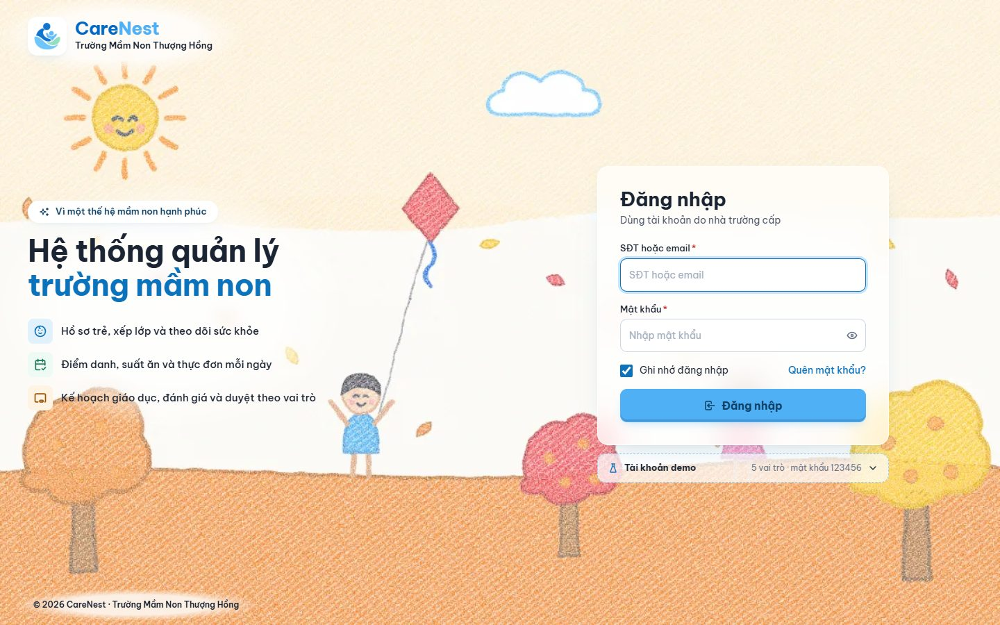
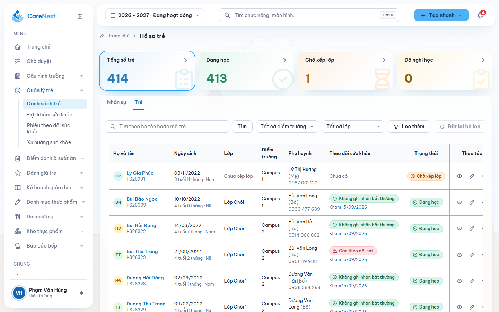
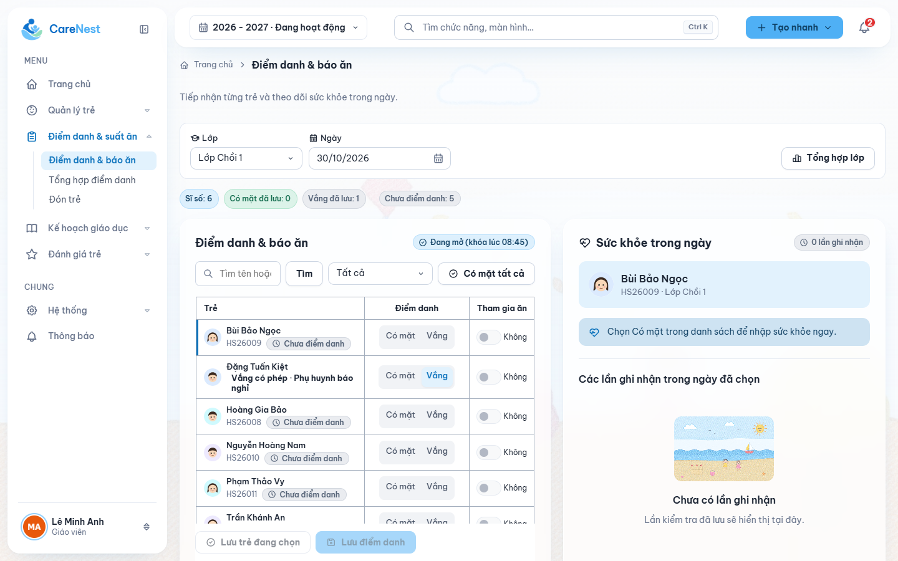
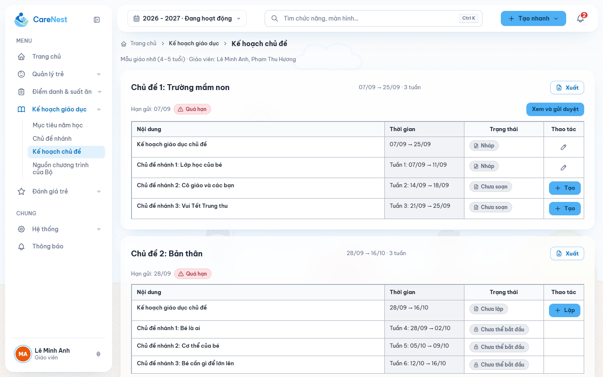
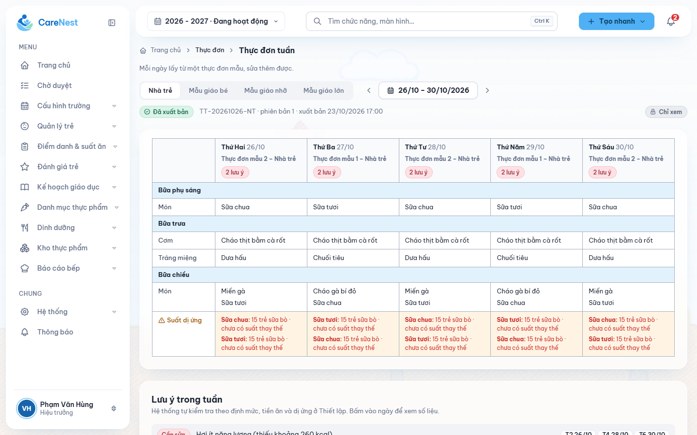
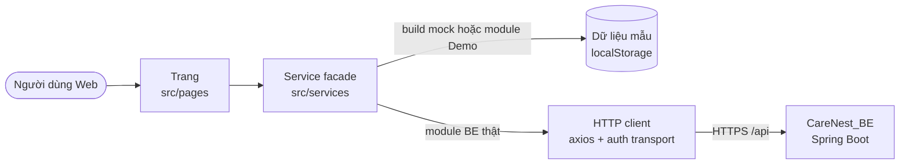

<div align="center">


# CareNest Web

Ứng dụng web quản lý vận hành và hồ sơ trẻ cho trường mầm non, dành cho Ban giám hiệu và giáo viên.


[Demo](https://web.carenest.edu.vn) · [Tài liệu](docs/INDEX.md) · [Backend](https://github.com/thang-04/CareNest_BE) · [Mobile](https://github.com/thang-04/CareNest_APP)

</div>

<p align="center">
  
</p>

## Giới thiệu

**CareNest** là hệ thống quản lý vận hành và hồ sơ trẻ cho trường mầm non. Thay cho việc ghi chép rời rạc trên nhiều công cụ và sổ giấy, CareNest gom các nghiệp vụ hằng ngày của nhà trường vào một hồ sơ có cấu trúc, lấy trẻ làm trung tâm.

Repo này là **client Web**: màn hình, điều hướng, trạng thái phía client và tích hợp API. Business rule, phân quyền và API contract thuộc về [CareNest_BE](https://github.com/thang-04/CareNest_BE); Web chỉ hiển thị và gửi yêu cầu, BE quyết định hợp lệ.

<table>
  <tr>
    <td width="50%"><p align="center"><b>Hồ sơ trẻ</b> và theo dõi sức khỏe</p></td>
    <td width="50%"><p align="center"><b>Điểm danh, báo ăn</b> và sức khỏe trong ngày</p></td>
  </tr>
  <tr>
    <td width="50%"><p align="center"><b>Kế hoạch giáo dục</b> theo chủ đề, tuần, ngày</p></td>
    <td width="50%"><p align="center"><b>Thực đơn tuần</b> và cảnh báo dị ứng</p></td>
  </tr>
</table>

## Hệ sinh thái CareNest

| Repo | Vai trò | Người dùng |
| --- | --- | --- |
| [CareNest_BE](https://github.com/thang-04/CareNest_BE) | REST API, business rule, phân quyền, dữ liệu. **Nguồn chuẩn** của toàn dự án | — |
| **CareNest_FE** (repo này) | Web | Quản trị hệ thống, Hiệu trưởng, Phó hiệu trưởng, Giáo viên (kể cả Tổ trưởng nhóm tuổi) |
| [CareNest_APP](https://github.com/thang-04/CareNest_APP) | Mobile | Giáo viên, Nhân viên bếp, Phụ huynh |

BE quyết định nền tảng theo client của token ([ADR-0022](https://github.com/thang-04/CareNest_BE/blob/dev/docs/decisions/ADR-0022-platform-access-from-token-client.md)): tài khoản Nhân viên bếp và Phụ huynh không đăng nhập được Web.

## Tính năng

| Nhóm chức năng | Nội dung |
| --- | --- |
| Đăng nhập, tài khoản | Đăng nhập, quên/đổi mật khẩu, hồ sơ cá nhân |
| Cấu hình trường | Năm học, điểm trường, phòng, nhóm tuổi và lớp, giờ chốt, nhân sự và phân công, xếp lớp |
| Phân quyền | Ma trận quyền theo vai trò, ngoại lệ theo người, lịch sử thay đổi |
| Quản lý trẻ | Hồ sơ trẻ, tiếp nhận, tài khoản phụ huynh, đợt khám, theo dõi sức khỏe |
| Điểm danh và suất ăn | Điểm danh, báo ăn, sức khỏe trong ngày, tổng hợp số suất |
| Đón trẻ | Xác minh người đón |
| Kế hoạch giáo dục | Mục tiêu năm học, chủ đề, giáo án tuần/ngày, duyệt theo chuỗi người ký, học liệu |
| Đánh giá trẻ | Đánh giá hằng ngày, nhận xét định kỳ, phiếu bé ngoan, khen thưởng |
| Thực đơn và dinh dưỡng | Thực phẩm, món ăn, thực đơn mẫu, thực đơn tuần, dị ứng |
| Bếp và kho | Nhập/xuất kho, hàng tươi, nhà cung cấp, lưu mẫu |
| Trang chủ, thông báo | Dashboard theo vai trò, danh sách chờ duyệt, thông báo |

## Tech stack

| Thành phần | Công nghệ |
| --- | --- |
| Ngôn ngữ | JavaScript (JSX), không TypeScript |
| UI | React 18.3, CSS thuần theo design token ([DESIGN.md](DESIGN.md)), Tabler Icons, Lottie |
| Build | Vite 8 (alias `@` → `src`) |
| Điều hướng | React Router 7, chặn màn theo vai trò |
| Dữ liệu | Axios, service facade chọn mock hoặc API theo module, `useAsync` cho server state, React Context cho UI state |
| Tiện ích | dnd-kit (kéo thả), jsPDF + html2canvas (xuất PDF), read-excel-file (nhập Excel) |
| Kiểm thử | `node:test` (unit), Playwright 1.63 (E2E) |
| Chất lượng | ESLint 8, Prettier 3, kiểm tra design token, kiểm tra API contract với BE |
| Triển khai | Docker (Node 22 build, nginx 1.27 runtime), Caddy (HTTPS), GitHub Actions |

## Kiến trúc



- Trang không gọi HTTP trực tiếp. Mỗi module có facade trong `src/services/<module>/` chọn giữa `mock/` (BE giả để demo, mỗi luật dẫn rule ID của BE) và `api/` (gọi BE thật).
- Ẩn nút, ẩn menu theo quyền chỉ là UX; BE vẫn kiểm tra quyền và trả 403/404, Web phải xử lý các kết quả đó.
- Đăng nhập thật đi qua gateway `/api/auth/*` của BE; access token chỉ giữ trong bộ nhớ, refresh token nằm trong cookie HttpOnly do BE quản lý ([AUTH_FLOW](docs/integration/AUTH_FLOW.md)).

```text
src/
├── pages/         màn hình theo module
├── components/    component dùng chung (ui/) và theo module
├── layouts/       khung app, sidebar, header, menu
├── routes/        định tuyến, chặn theo vai trò
├── services/      facade + api/ + mock/ theo module, http client
├── mocks/         dữ liệu mẫu, mock database
├── config/        cấu hình app, nguồn dữ liệu từng module
├── contexts/      Auth, Toast, SchoolYear, Appearance
├── hooks/  utils/  models/
├── styles/        token, layout, CSS theo module
└── assets/        logo, minh họa, Lottie
```

Quy tắc thư mục, luồng dữ liệu và cách thêm module mới: [CODING_GUIDE](docs/architecture/CODING_GUIDE.md).

## Bắt đầu nhanh

Yêu cầu: Node.js 22 (bản CI và Docker đang dùng), npm.

```bash
git clone https://github.com/thang-04/CareNest_FE.git
cd CareNest_FE
npm ci --legacy-peer-deps
npm run dev
```

Mở <http://localhost:5173>. Chế độ mặc định chạy hoàn toàn trên dữ liệu mẫu, không cần BE.

> `--legacy-peer-deps` là bắt buộc: `@vitejs/plugin-react` 4.x chưa khai báo hỗ trợ Vite 8 nên npm báo `ERESOLVE` ([ghi chép](docs/knowledge/incidents/FE-ENV-261009-npm-eresolve-vite8-plugin-react.md)).

Nối với BE thật (đăng nhập qua gateway, chọn nguồn dữ liệu): [AUTH_FLOW](docs/integration/AUTH_FLOW.md) và [BACKEND_INTEGRATION](docs/integration/BACKEND_INTEGRATION.md); mẫu cấu hình ở [`.env.example`](.env.example).

## Kiểm thử và cổng chất lượng

| Lệnh | Việc |
| --- | --- |
| `node scripts/verify.mjs` | **Cổng bắt buộc trước khi báo xong hoặc mở PR**: chạy `npm run verify` và tự bật git hook |
| `npm run verify` | 7 bộ unit test (`tests/`) + `npm run check` |
| `npm run check` | ESLint, Prettier, kiểm tra design token, đối chiếu lời gọi API với snapshot OpenAPI của BE, build |
| `npm run test:e2e` | Playwright; cần BE, Keycloak và PostgreSQL thật ([hướng dẫn](tests/e2e/README.md)) |

Tiêu chí hoàn thành: [DEFINITION_OF_DONE](docs/quality/DEFINITION_OF_DONE.md), bằng chứng kiểm chứng: [VERIFICATION](docs/quality/VERIFICATION.md).

## Triển khai

Workflow [`deploy.yml`](.github/workflows/deploy.yml) chỉ chạy trên `main`, bỏ qua thay đổi chỉ có tài liệu:

- PR vào `main`: chạy `npm run verify`.
- Push vào `main`: verify, đồng bộ source lên VPS, `docker compose up -d --build`, cập nhật site Caddy, kiểm tra HTTPS.

Trên VPS, Caddy phục vụ <https://web.carenest.edu.vn>: request `/api/*` chuyển sang BE, phần còn lại vào container nginx chứa bundle React. Cài đặt VPS, secret, rollback: [DEPLOYMENT](docs/integration/DEPLOYMENT.md).

## Cấu trúc repo

```text
CareNest_FE/
├── src/                     source React
├── tests/                   unit (node:test), e2e (Playwright)
├── scripts/                 verify, check-design, check-api-contract, check-ai-layer
├── docs/                    kiến trúc, tích hợp, triển khai, knowledge, plan
├── mockups/                 ảnh thiết kế gốc
├── deploy/, docker/         site Caddy, template nginx
├── .github/workflows/       CI/CD
├── .githooks/               commit-msg, pre-commit, pre-push
├── Dockerfile, compose.yaml build và chạy container
├── DESIGN.md                design system chung Web + App
└── AGENTS.md, CLAUDE.md, .ai/, .claude/, .agents/   hướng dẫn cho AI agent
```

## Tài liệu

| Cần | Đọc |
| --- | --- |
| Quy tắc code (**đọc trước khi code**) | [CODING_GUIDE](docs/architecture/CODING_GUIDE.md) |
| Design system: màu, chữ, component, bố cục | [DESIGN.md](DESIGN.md), [mockups](mockups/README.md) |
| Mục lục toàn bộ tài liệu | [docs/INDEX.md](docs/INDEX.md) |
| Kiến trúc Web | [FRONTEND_ARCHITECTURE](docs/architecture/FRONTEND_ARCHITECTURE.md), [STATE_MANAGEMENT](docs/architecture/STATE_MANAGEMENT.md) |
| Màn hình theo vai trò | [ROUTE_MAP](docs/architecture/ROUTE_MAP.md) |
| Đăng nhập, phiên, nối BE | [AUTH_FLOW](docs/integration/AUTH_FLOW.md), [BACKEND_INTEGRATION](docs/integration/BACKEND_INTEGRATION.md) |
| Nghiệp vụ theo màn hình | [docs/features](docs/features/README.md) |
| Trạng thái từng nhóm màn | [CURRENT_STATE](docs/context/CURRENT_STATE.md) |
| Lỗi đã gặp | [ISSUE_INDEX](docs/knowledge/ISSUE_INDEX.md), [TROUBLESHOOTING](docs/knowledge/TROUBLESHOOTING.md) |
| Business rule, phân quyền, API contract | [CareNest_BE docs](https://github.com/thang-04/CareNest_BE/blob/dev/docs/INDEX.md) |

## Quy ước đóng góp

- **Nhánh:** `main` là bản phát hành đã duyệt, `dev` để tích hợp, `release/*` để kiểm thử bản phát hành. Nhánh làm việc tạo từ `dev`, đặt tên `<feature|fix>/<mã-jira>-<mã-công-việc>-<tên-luồng>`, ví dụ `feature/G94-181-FE-FEAT-44-lesson-plan`.
- **Commit:** `<mã-jira>: <mô tả tiếng Anh>`, cả dòng tối đa 72 ký tự, mỗi commit một thay đổi logic, không ghi tên công cụ AI.
- **Pull request:** gộp vào `dev`; chỉ `release/*` được gộp vào `main`. Cần ít nhất một thành viên khác duyệt và mọi kiểm tra bắt buộc đạt.
- **Git hook** (`.githooks/`, bật tự động khi chạy `node scripts/verify.mjs`): chặn commit sai định dạng, file secret, push thẳng lên `main` và force push.
- **Không commit** secret hay dữ liệu trẻ thật; repo chỉ chứa mẫu cấu hình (`.env.example`).

Chi tiết và các việc cần trao đổi với team trước khi làm: [AGENTS.md](AGENTS.md), mục "Quy tắc chung CareNest".
