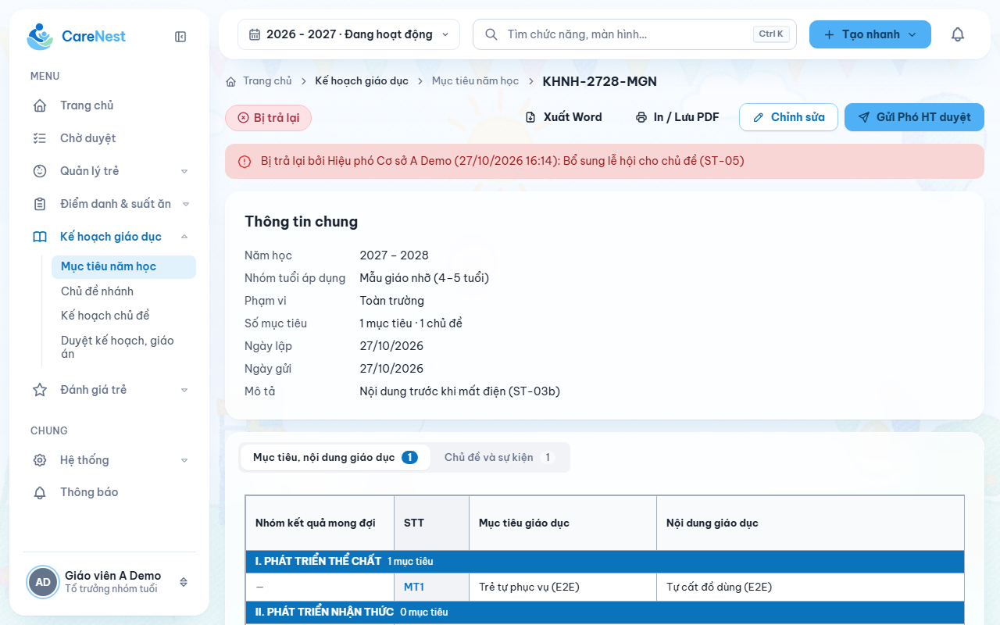
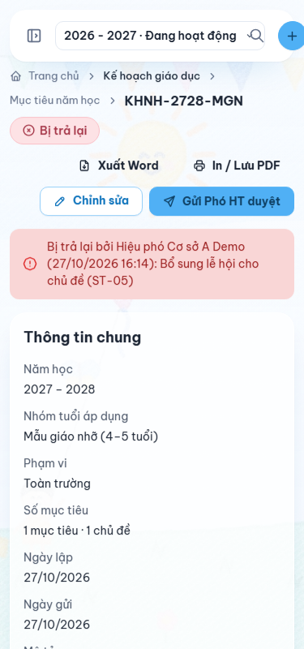
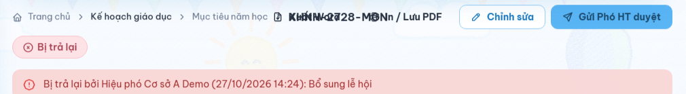

# Báo cáo kiểm thử Playwright — Kế hoạch giáo dục (27/10/2026)

- **Người thực hiện:** Claude cho Nguyễn Quang Tiền (SEP490-G94), nhánh `feature/G94-178-FE-FEAT-41-lesson-assessment-parent`.
- **Môi trường:**
  - FE: bản build chạy bằng `vite preview`, `VITE_USE_MOCK=false`.
  - BE: CareNest_BE profile `dev` (Java 21, `:8080`).
  - Keycloak realm dev (`:8180`), Postgres Docker `carenest_be-postgres-1`.
  - Chromium Playwright 1.63.0.
- **Nguồn nghiệp vụ:** `CareNest_BE/docs/business/flows/education-plan.md`, BUSINESS_RULES EDU-01..23 (EDU-22 cập nhật 27/10: lưu tay + bản giữ ẩn).
- **Lệnh:** `npm run test:e2e` (cách chuẩn bị môi trường: `tests/e2e/README.md`).
- **Kết quả lần chạy cuối (sau khi sửa A, B1–B3, chiều 27/10):** **31/31 Pass**. Integration 17/17, System 14/14, thời gian 3,4 phút. (Lần trước: 27/27.)
- **Dữ liệu:** test chỉ tạo kế hoạch `[E2E]` của năm 2027-2028, nhóm Mẫu giáo nhỡ, lớp B1 (2027-2028), cùng phân công Tổ trưởng tạm. Sau khi chạy đã kiểm DB: 0 kế hoạch `[E2E]`, phân công Tổ trưởng của teacher1 trở lại `valid_from = 2026-09-01`.

## 1. Integration (FE contract ↔ BE thật, qua Keycloak thật) — `tests/e2e/integration/edu-plan-api.spec.mjs`

| ID | Loại | Actor | Bước | Kết quả mong đợi | Kết quả thực tế | Pass/Fail |
| --- | --- | --- | --- | --- | --- | --- |
| IT-01 | integration | GV, Phó HT | GET/PUT `/education-plans/config` | Mọi vai trò đọc được; GV sửa ⇒ 403; Phó HT lưu lại cùng nội dung ⇒ 200, người ký giữ nguyên | Đúng | Pass |
| IT-02 | integration | GV thường (teacher2) | POST tạo kế hoạch năm | 403 | 403 | Pass |
| IT-03 | integration | Tổ trưởng (teacher1) | POST tạo (có header phiên sửa), PUT lưu lần 2 | 201, trạng thái `EDITING` (Đang sửa), revision tăng 1 sau mỗi lần lưu | Đúng | Pass |
| IT-04 | integration | Phó HT | start-editing khi Tổ trưởng đang giữ phiên | 409 (một người sửa, EDU-10), câu "Đang được [tên] sửa" | Đúng | Pass |
| IT-05 | integration | Tổ trưởng | PUT với revision cũ | 409, không ghi đè, câu tiếng Việt | Đúng | Pass |
| IT-05b | integration | Tổ trưởng, Phó HT | Cùng tài khoản start-editing bằng phiên mới khi phiên cũ còn giữ quyền; phiên cũ heartbeat/PUT/finish; Phó HT start-editing | Phiên mới 200 ngay; phiên cũ 409 "Đã mất quyền sửa…", không nhả được quyền mới; Phó HT vẫn 409 | Đúng | Pass |
| IT-06 | integration | GV thường | GET kế hoạch chưa ban hành | 403/404 | Bị chặn | Pass |
| IT-07 | integration | Tổ trưởng → Phó HT | submit → start-editing → return không lý do → return có lý do | `PENDING_VP`; trả lại không lý do ⇒ 400; có lý do ⇒ `REJECTED` | Đúng | Pass |
| IT-08 | integration | Tổ trưởng | Gửi kế hoạch của nhóm tuổi khác; tự ban hành | Bị chặn (403/409); ban hành ⇒ 403 | Đúng | Pass |
| IT-09 | integration | Tổ trưởng, Phó HT, GV | Sửa bản bị trả lại → gửi lại → Phó HT ban hành → GV xem → Tổ trưởng xin sửa | `APPROVED`; GV đọc được (200); xin sửa bản đã ban hành bị chặn | Đúng | Pass |
| IT-10 | integration | GV lớp B1, GV khác lớp | PUT chủ đề nhánh; gửi khi còn tuần chưa đặt tên | GV khác lớp ⇒ 403; chưa đủ tên ⇒ 409; đủ tên lưu ⇒ 200 | Đúng | Pass |
| IT-11 | integration | GV lớp | PUT kế hoạch chủ đề khi chủ đề nhánh chưa duyệt | 409 | 409 | Pass |
| IT-12 | integration | GV, Tổ trưởng, Phó HT | Gửi → GV/Phó HT duyệt sai lượt → Tổ trưởng trả lại (thiếu/có lý do) → gửi lại → Tổ trưởng duyệt → Phó HT duyệt | `PENDING_TL`; sai lượt ⇒ 403; thiếu lý do ⇒ 400; `REJECTED`; `PENDING_VP`; `APPROVED` | Đúng | Pass |
| IT-13 | integration | GV lớp | Lưu kế hoạch chủ đề; gửi hồ sơ khi thiếu giáo án nhánh; lưu giáo án tuần; gửi riêng giáo án tuần | 200; 409; 200; 400 ("gửi cùng kế hoạch chủ đề") | Đúng | Pass |
| IT-14 | integration | GV kiêm Tổ trưởng, Phó HT | Gửi hồ sơ chủ đề → Phó HT duyệt → sửa giáo án tuần | Bỏ bước Tổ trưởng (`PENDING_VP`); duyệt xong giáo án tuần bị khóa (409) | Đúng | Pass |
| IT-15 | integration | GV lớp | Tải học liệu lên hồ sơ chủ đề đã duyệt | 409 (chỉ Nháp/Bị trả lại mới sửa học liệu) | 409 | Pass |
| IT-16 | integration | GV lớp | Tải học liệu thiếu part `activitySignature` | 400 "Thiếu dữ liệu bắt buộc: activitySignature" (không 500) | Đúng | Pass |

## 2. System (người dùng thật trên trình duyệt, nhiều vai trò, BE thật) — `tests/e2e/system/edu-plan-flows.spec.mjs`

Bản nháp kế hoạch năm (1 mục tiêu, 1 chủ đề 06–10/09/2027) được dựng sẵn bằng API; mọi bước còn lại đều thao tác trên giao diện.

| ID | Loại | Actor | Bước | Kết quả mong đợi | Kết quả thực tế | Pass/Fail |
| --- | --- | --- | --- | --- | --- | --- |
| ST-01 | system | Tổ trưởng | Mở soạn kế hoạch năm, sửa Mô tả, chờ 4 giây, bấm Ctrl+S | Trạng thái "Có thay đổi chưa lưu"; không có chữ nào về tự lưu; sau 4 giây hệ thống chưa đổi; Ctrl+S ⇒ "Đã lưu lúc hh:mm" và hệ thống có nội dung mới | Đúng | Pass |
| ST-02 | system | Tổ trưởng | Sửa, bấm menu "Mục tiêu năm học" → Hủy → bấm lại → Không lưu | Hộp Hủy · Không lưu · Lưu; Hủy thì ở lại; Không lưu thì rời màn, xóa bản giữ ẩn, hệ thống giữ bản cũ | Đúng | Pass |
| ST-03 | system | Tổ trưởng | Sửa, đóng tab (trình duyệt hỏi) → mở lại → Khôi phục → Ctrl+S | Có hộp `beforeunload`; mở lại hiện "Có nội dung chưa lưu từ lần soạn trước." (Khôi phục/Bỏ); khôi phục đúng nội dung; Lưu xong xóa bản giữ | Đúng | Pass |
| ST-03b | system | Tổ trưởng | Sửa (có bản giữ), để tab cũ sống không nhả quyền (như mất điện) → mở tab mới cùng tài khoản | Tab mới mời khôi phục, nút Khôi phục bấm được ngay (không chờ 90 giây); tab cũ ≤20 giây hiện "Đã mất quyền sửa…", khóa form, bản giữ còn; Khôi phục + Ctrl+S lưu đúng | Đúng | Pass |
| ST-04 | system | Tổ trưởng | "Gửi Phó HT duyệt" → Gửi | `PENDING_VP` | Đúng | Pass |
| ST-05 | system | Phó HT, Tổ trưởng | "Trả lại" không ghi lý do → ghi lý do → Tổ trưởng mở chi tiết | Báo "Vui lòng ghi lý do trả lại"; `REJECTED`; Tổ trưởng thấy lý do | Đúng | Pass |
| ST-05b | system | Tổ trưởng | Mở chi tiết bản Bị trả lại ở 1280px và 375px; đối chiếu khung mã kế hoạch với các nút đầu trang | Không chồng lên nhau. Khi gỡ quy tắc CSS sửa lỗi ngay trên trang thì phép kiểm phát hiện chồng (đúng lỗi B1). Ảnh:    | Đúng | Pass |
| ST-06 | system | Tổ trưởng, Phó HT, GV | Gửi lại → Phó HT "Ban hành" → GV mở chi tiết | `APPROVED`; GV xem được, không có nút sửa | Đúng | Pass |
| ST-07 | system | GV lớp B1 | Chọn năm 2027-2028 ở header → Chủ đề nhánh → đặt tên → Lưu → Gửi | Trạng thái lưu tay, không có chữ tự lưu; `PENDING_TL` | Đúng | Pass |
| ST-08 | system | Tổ trưởng, Phó HT, GV | Tổ trưởng Duyệt → Phó HT Trả lại có lý do → GV thấy lý do, sửa, Ctrl+S, gửi lại → Tổ trưởng → Phó HT Duyệt | `PENDING_VP` → `REJECTED` → `PENDING_TL` → `APPROVED` | Đúng | Pass |
| ST-09 | system | GV lớp | Kế hoạch chủ đề: sửa → Ctrl+S | "Đã lưu lúc"; tài liệu có trên hệ thống | Đúng | Pass |
| ST-10 | system | GV lớp | Giáo án tuần: sửa → đóng tab → mở lại → Khôi phục → Ctrl+S | Có bản giữ (1 khóa); mời khôi phục; khôi phục đúng; Lưu xóa bản giữ | Đúng | Pass |
| ST-11 | system | GV kiêm Tổ trưởng | Sửa giáo án tuần rồi đóng tab (còn bản giữ) → gửi hồ sơ chủ đề → mở lại giáo án tuần | Gửi thẳng Phó HT (`PENDING_VP`); không mời khôi phục vì tài liệu đã đổi trạng thái; bản giữ cũ bị xóa | Đúng | Pass |
| ST-12 | system | Phó HT, GV | Phó HT Duyệt hồ sơ → GV mở Dạy học/Trình chiếu | `APPROVED`; trình chiếu hiện hoạt động của kế hoạch chủ đề, nút "Toàn màn hình", nhãn "Đã duyệt" | Đúng | Pass |

## 3. Lỗi và điểm cần chú ý phát hiện khi chạy

Không có ca kiểm thử nào fail ở lần chạy cuối. Các vấn đề dưới đây phát hiện ở lượt sáng 27/10; **B1, B2, B3, Q1 đã sửa chiều 27/10** theo chốt của Tiền (xem cột Trạng thái ở bảng sau), N1, N2 giữ nguyên.

| # | Trạng thái (chiều 27/10) |
| --- | --- |
| B1 | Đã sửa: CSS khoanh vùng hàng đầu trang chi tiết kế hoạch năm (`education-plan.css`, chỉ ≥1024px, dùng token sẵn có). Kiểm bởi ST-05b |
| B2 | Đã sửa: thông báo phiên/revision là câu ngắn tiếng Việt ("Đang được [tên] sửa", "Đã mất quyền sửa…", "Kế hoạch đã được thay đổi ở nơi khác. Tải lại để đối chiếu"). Kiểm bởi IT-04, IT-05, IT-05b |
| B3 | Đã sửa: 400 "Thiếu dữ liệu bắt buộc: <tên>". Kiểm bởi IT-16 và test BE |
| Q1 | Đã xử lý theo chốt: cùng tài khoản mở lại thì nhận quyền ngay (EDU-10); tab cũ mất quyền và giữ bản giữ. Kiểm bởi IT-05b, ST-03b |

Bảng phát hiện gốc (lượt sáng):

| # | Mức | Nơi | Mô tả | Cách tái hiện | Đề xuất |
| --- | --- | --- | --- | --- | --- |
| B1 | Trung bình | FE (giao diện) | Trang chi tiết kế hoạch năm khi có 2 nút hành động (Bị trả lại: "Chỉnh sửa" + "Gửi Phó HT duyệt"): mã kế hoạch và nút "Xuất Word / In / Lưu PDF" bị chồng chữ lên nhau ở hàng breadcrumb. Ảnh:  | Tổ trưởng mở `/education/goals/:id` của bản Bị trả lại ở độ rộng 1280px | Sửa bố cục đầu trang (cần đổi CSS, ngoài phạm vi "không đổi style" của lượt này) |
| B2 | Thấp | BE | Lỗi phiên sửa/revision trả câu tiếng Anh, và UI hiện nguyên văn: "Another editing session holds this plan", "Plan changed; reload and compare your recovery draft", "You cannot edit this plan"… | Hai tab cùng sửa một kế hoạch năm, hoặc mở lại trong 90 giây sau khi đóng tab | Việt hóa thông điệp ở `EduYearPlanServiceImpl` (BE) |
| B3 | Thấp | BE | Gửi multipart thiếu phần (vd. `activitySignature`) khi tải học liệu ⇒ 500 "Internal server error" thay vì 400 | POST `/class-docs/theme/{key}/learning-resources` thiếu một part | `GlobalExceptionHandler` map `MissingServletRequestPartException` ⇒ 400 |
| Q1 | Cần chốt | FE kế hoạch năm | Mở lại trong vòng 90 giây sau khi đóng tab đột ngột (mất điện): phiên sửa cũ vẫn giữ quyền. Nút "Khôi phục" chưa bấm được vì cần quyền sửa. Nút "Thử nhận quyền sửa" cũng bị khóa khi đang có khung khôi phục (`disabled={saver.unsaved \|\| !!saver.recovery}`). Theo code, trang tự thử nhận lại quyền mỗi 20 giây nên tối đa khoảng 110 giây sẽ khôi phục được; trong lúc chờ chỉ có thông báo tiếng Anh (B2). Đóng tab bình thường thì quyền được nhả đúng (ST-03). | Đóng tab mà trang không kịp gửi yêu cầu nhả quyền, rồi mở lại ngay | Hỏi Tiền: có cần câu báo rõ ("Đang chờ phiên trước hết hạn…") hoặc cho bấm "Thử nhận quyền sửa" khi đang có khung khôi phục không |
| N1 | Ghi chú | FE (shim đăng nhập dev) | `authService` (đánh dấu "TEMP DEMO SHIM") chỉ đọc phân công Tổ trưởng **đầu tiên**. Ai kiêm Tổ trưởng 2 nhóm tuổi sẽ không thấy nút Duyệt của nhóm thứ hai, dù BE cho phép. Bộ test đã tránh bằng cách tạm ngưng phân công thứ hai. | Gán 2 phân công Tổ trưởng cho cùng một người | Xử lý khi thay shim bằng đăng nhập thật |
| N2 | Ghi chú | FE | Danh sách kế hoạch năm của Phó HT gọi GET chi tiết từng kế hoạch (N+1) sau khi lấy danh sách | Xem log BE khi mở `/education/goals` | Cân nhắc dùng dữ liệu tóm tắt của danh sách |

**Độ ổn định:**
- Bộ đầy đủ đã chạy 3 lần trên bản build: 2 lần 27/27, 1 lần ST-01 fail. Lần fail đó trang hiện "Ứng dụng vừa được cập nhật" (nạp chunk JS động thất bại ngay sau khi Playwright vừa build lại). Chạy lại thì qua; tôi chưa tái hiện được, nên xếp là chập chờn do môi trường.
- Khi chạy bằng `vite` dev server, lỗi này xảy ra thường xuyên vì dev server tự tối ưu lại dependency giữa chừng. Đó là lý do bộ test dùng bản build + `vite preview`.

**Đã sửa trong lượt này:** không sửa sản phẩm, chỉ sửa chính các test (selector, chờ nhả phiên sửa, chạy bằng bản build thay dev server). Lỗi phát hiện ở lượt trước (bản giữ năm học còn sót sau Khôi phục + Lưu) đã được sửa và được ST-03 xác nhận.

## 4. Chưa kiểm thử và lý do

- **Tải học liệu thành công, gắn lại, gỡ:** BE dev chưa cấu hình kho S3 (`CARENEST_EDUCATION_MEDIA_*`). Chỉ kiểm được quy tắc khóa (IT-15).
- **Bước Hiệu trưởng ký:** cấu hình người ký hiện tại không có HT. Test đã có nhánh xử lý `PENDING_HT` nhưng chưa được chạy tới.
- **Đánh giá trẻ hằng ngày sau khi giáo án tuần được duyệt:** ngoài phạm vi màn kế hoạch, chưa viết.
- **Kế hoạch ngày (5 ngày trong giáo án tuần):** mới lưu ở mức tài liệu tuần, chưa thao tác riêng từng tab ngày.
- **Màn Cấu hình kế hoạch trên UI:** chỉ kiểm API (IT-01).
- **Chế độ mock:** không chạy vì đã chạy được trên BE thật.
